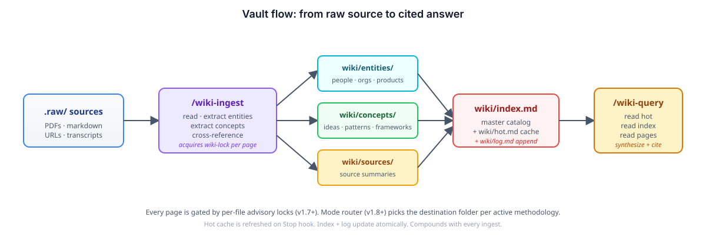
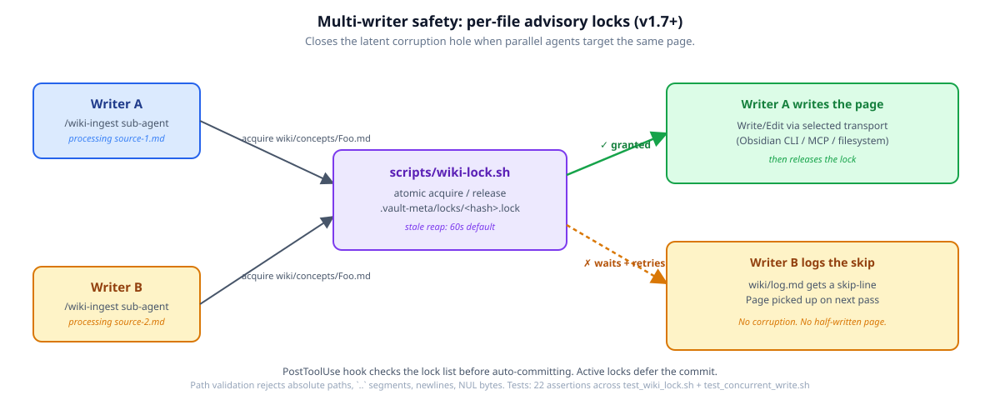
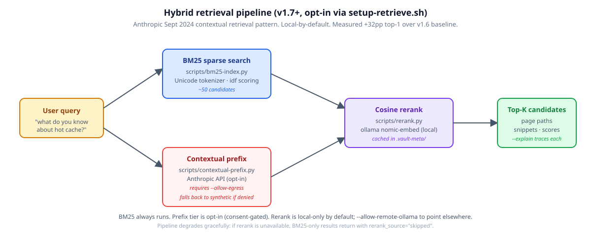

# codex-obsidian

Codex + Obsidian 的本地优先知识库工具包。它把 Obsidian vault 当作一个长期维护的 wiki：原始资料放在 `.raw/`，Codex 负责提炼、建页、互链、回答问题、做健康检查，并把重要对话保存回 wiki。

这个项目迁移自 [`AgriciDaniel/claude-obsidian`](https://github.com/AgriciDaniel/claude-obsidian)，核心机制保留，默认运行身份改为 Codex，默认产出语言改为简体中文。

## 目录

- [快速开始](#快速开始)
- [项目边界](#项目边界)
- [架构](#架构)
  - [Vault flow](#vault-flow)
  - [多写者安全](#多写者安全)
  - [混合检索](#混合检索)
- [默认语言策略](#默认语言策略)
- [Vault 目录布局](#vault-目录布局)
- [Commands / Skills](#commands--skills)
  - [`/wiki`：初始化、脚手架、继续维护](#wiki：初始化、脚手架、继续维护)
  - [`wiki-ingest`：资料摄取](#wiki-ingest：资料摄取)
  - [`wiki-query`：基于 wiki 回答](#wiki-query：基于-wiki-回答)
  - [`save`：把对话沉淀成页面](#save：把对话沉淀成页面)
  - [`autoresearch`：多轮自主研究](#autoresearch：多轮自主研究)
  - [`canvas`：可视化层](#canvas：可视化层)
  - [`think`：10-principle thinking loop](#think：10-principle-thinking-loop)
  - [`wiki-mode`：组织方法论](#wiki-mode：组织方法论)
  - [`wiki-retrieve`：chunk-level 检索](#wiki-retrieve：chunk-level-检索)
  - [`wiki-cli`：vault transport](#wiki-cli：vault-transport)
  - [`wiki-lint`：健康检查](#wiki-lint：健康检查)
  - [`wiki-fold`：log rollup](#wiki-fold：log-rollup)
  - [`defuddle`：网页清理](#defuddle：网页清理)
  - [Obsidian 写作和 Bases](#obsidian-写作和-bases)
- [测试](#测试)
- [来源和许可](#来源和许可)

## 快速开始

从零开始创建一个新的 `codex-obsidian` vault：

```bash
# 推荐：下载 release zip/tarball 后解压，而不是直接把开发 clone 当长期 vault。
cd codex-obsidian
git init
bash bin/setup-multi-agent.sh
bash bin/setup-vault.sh
git add -A
git commit -m "Initial codex-obsidian vault"
```

然后：

1. 在 Obsidian 中打开 `codex-obsidian/` 作为 vault。
2. 在这个 `codex-obsidian` 目录下启动 Codex，或在 Codex Desktop 中打开这个目录作为 workspace。
3. 在 Codex 中输入 `/wiki`，或直接说“设置这个 wiki”。

第一次 `/wiki` 会询问这个 vault 的用途，但不会再按用途创建额外目录。默认只创建实际接入路由的核心布局；新页面如何归档由 `wiki-mode` 控制。

如果你使用的是源码 clone，要先注意 `.gitignore`：开发仓库为了不提交演示运行态，会忽略 `/wiki/`、`/.raw/`、`/.vault-meta/`。个人 vault 不应该这样配置，否则 Codex hooks 和 Git 都不会记录你的 wiki 历史。已有 Obsidian vault、希望把工具仓库和 vault 分开、或想了解 mode 怎么选，见 [详细快速开始](docs/quick-start.md)。

## 项目边界

根目录的 `wiki/`、`.raw/`、`.obsidian/` 都是运行态内容，由 `bin/setup-vault.sh` 创建。这个仓库本身只维护工具、模板和说明，不直接携带演示 wiki 历史。

作为个人 vault 使用时，`wiki/`、`.raw/` 和 `.vault-meta/` 是你的知识库历史，应该进入 Git。只有开发 `codex-obsidian` 源码本身时，才应通过源码仓库的 `.gitignore` 忽略这些运行态目录。

核心目录：

- `skills/`：Codex 可发现的 Agent Skills。
- `scripts/`：检索、锁、路由、lint、地址分配等工具脚本。
- `bin/`：安装和初始化脚本。
- `_templates/`：Obsidian 笔记模板。
- `tests/`：迁移后的回归测试。
- `AGENTS.md`：Codex 维护本项目和生成 vault 时的入口说明。
- `WIKI.md`：生成后 vault 的简明 schema 参考。

## 架构

`codex-obsidian` 的核心不是一个聊天界面，而是一套围绕 Obsidian vault 运转的知识库流水线。原始资料、wiki 页面、索引、热缓存、检索索引和写入锁各自分层，Codex 通过 skills 调用这些层。

### Vault flow

资料先进入 `.raw/`。`wiki-ingest` 读取原始资料，抽取实体、概念和 source 摘要，并按当前 methodology mode 写入 `wiki/` 下的对应目录。每次写入后都会更新 `wiki/index.md`、`wiki/log.md` 和 `wiki/hot.md`。

查询时，`wiki-query` 按 `hot.md -> index.md -> 相关页面` 的顺序读取，先用低成本上下文缩小范围，再综合回答并引用具体 wiki 页面。

<p align="center">
  
</p>

### 多写者安全

批量 ingest 时，多个 agent 可能同时想更新同一个 wiki 页面。`scripts/wiki-lock.sh` 提供单文件 advisory lock：一个 writer 拿到锁并写入，其他 writer 等待或跳过到下一轮。PostToolUse 自动提交 hook 也会先检查锁列表，有活动锁时推迟提交，避免提交半写状态。

Codex 原生 hooks 配置在 `.codex/hooks.json`，实际脚本在 `hooks/`。`SessionStart` 会读取 `wiki/hot.md` 恢复上下文；`PostToolUse` 会在 `Edit`、`Write` 或 `apply_patch` 后自动提交 `wiki/`、`.raw/`、`.vault-meta/` 的变更。`bin/setup-multi-agent.sh` 会为当前 vault 或指定 vault 写入这份配置。

<p align="center">
  
</p>

### 混合检索

`wiki-retrieve` 是可选增强。基础路径始终可用；启用后会把页面切成 chunks，建立 BM25 稀疏索引，并可用本地 ollama embedding 做 cosine rerank。contextual prefix 的远端 LLM 路径默认需要显式 consent；不同 tier 不可用时会自动降级。

```bash
bash bin/setup-retrieve.sh          # 正常 provision
bash bin/setup-retrieve.sh --no-llm # 只使用本地 synthetic prefix
bash bin/setup-retrieve.sh --check  # 只做诊断
```

<p align="center">
  
</p>

更完整的架构说明见 [docs/compound-vault-guide.md](docs/compound-vault-guide.md)。

## 默认语言策略

除非用户明确要求其他语言，所有由 Codex 新建或更新的 wiki 内容都使用简体中文：

- 英文资料：中文总结，保留必要英文术语和专有名词。
- 中文资料：中文总结。
- 中英混合资料：中文总结。
- 其他语言资料：翻译并总结为中文。

新页面 frontmatter 使用 `language: zh`。引用、文件名、实体名可以保留通用英文名称。

## Vault 目录布局

默认布局只保留实际被 skills 写入和维护的核心目录：

| 目录 | 用途 |
|---|---|
| `wiki/sources/` | 原始资料摘要页 |
| `wiki/entities/` | 人物、组织、产品、工具和系统实体 |
| `wiki/concepts/` | 概念、模式、框架和方法 |
| `wiki/domains/` | 长期主题领域 |
| `wiki/questions/` | 保存的综合问答和开放问题 |
| `wiki/comparisons/` | 对比分析 |
| `wiki/sessions/` | 会话级保存页 |
| `wiki/canvases/` | Obsidian Canvas |
| `wiki/meta/` | 运行态元信息、报告和仪表盘 |

早期版本文档中的 A-F Vault 用例模式不再创建物理目录。它们描述的是用途，不是归档路由；没有 skill 自动写入那些目录时，空目录只会干扰 Obsidian 文件树。更完整的布局策略见 [skills/wiki/references/modes.md](skills/wiki/references/modes.md)。

## Commands / Skills

Codex 通过 `skills/<name>/SKILL.md` 发现和执行这些能力。你可以使用 slash command，也可以用自然语言触发；真正的完整规则以对应的 `SKILL.md` 为准。

| 你可以这样说 | 对应 skill | Codex 做什么 |
|---|---|---|
| `/wiki`、`设置这个 wiki` | `wiki` | 检查 vault、初始化结构、维护 `hot.md`，并路由到子 skill |
| `ingest paper.pdf`、`ingest this url` | `wiki-ingest` | 读取资料，先给出审阅草稿；确认后生成 source/entity/concept 页面并更新索引、日志和 hot cache |
| `ingest all of these` | `wiki-ingest` | 批量摄取多份资料；默认逐份审阅，确认后写入，并用锁避免并行写入冲突 |
| `what do you know about X?`、`query: X` | `wiki-query` | 按 `hot -> index -> pages` 检索并用 wiki 引用回答 |
| `query deep: X` | `wiki-query` + `wiki-retrieve` | 使用更深读取和可选 chunk 检索做综合回答 |
| `/save`、`save this answer` | `save` | 把当前对话、结论或分析保存为结构化 wiki 页面 |
| `/autoresearch <主题>` | `autoresearch` | 多轮搜索、抓取、综合、归档，生成研究页和相关页面 |
| `/canvas` | `canvas` | 打开或创建 Obsidian Canvas，并列出现有 nodes/zones |
| `/canvas add image <path>` | `canvas` | 把图片加入 Canvas，并自动布局 |
| `/canvas add text <内容>` | `canvas` | 加入 Markdown 文本卡片 |
| `/canvas add pdf <path>` | `canvas` | 把 PDF 作为预览节点加入 Canvas |
| `/canvas add note <页面>` | `canvas` | 把 wiki 页面固定为 Canvas 链接卡 |
| `/canvas zone <名称>` | `canvas` | 创建分组 zone |
| `/think <问题>` | `think` | 用 10-principle thinking loop 做结构化推理、审计或决策 |
| `lint the wiki`、`check the wiki` | `wiki-lint` | 检查孤儿页、死链、frontmatter、陈旧声明、语义重复等 |
| `set vault mode`、`switch to PARA` | `wiki-mode` | 配置 LYT / PARA / Zettelkasten / Generic 归档模式 |
| `retrieve X`、`search the chunks` | `wiki-retrieve` | 运行 BM25 + 可选 rerank 的 chunk-level 检索 |
| `which transport?`、`obsidian cli` | `wiki-cli` | 检测和解释 vault 读写 transport：CLI / MCP / filesystem |
| `fold the log, dry-run k=3` | `wiki-fold` | 对 `wiki/log.md` 最近 `2^k` 条做 extractive rollup 预览 |
| `fold the log, commit k=3` | `wiki-fold` | 写入 fold 页面、更新 index 和 log |
| `defuddle <url>`、`clean this page` | `defuddle` | 清理网页正文，去掉导航、广告和模板噪声，再用于 ingest |
| `obsidian markdown`、`wikilink format` | `obsidian-markdown` | 查询 Obsidian Flavored Markdown 写法：wikilink、embed、callout、frontmatter |
| `create a base`、`base view` | `obsidian-bases` | 创建或编辑 Obsidian Bases `.base` 数据视图 |

### `/wiki`：初始化、脚手架、继续维护

第一次运行时，`wiki` 会检查当前目录是否已经是 vault，创建核心结构，并生成核心页面：

- `wiki/index.md`：主索引；
- `wiki/log.md`：操作日志；
- `wiki/hot.md`：最近上下文热缓存；
- `wiki/overview.md`：知识库概览；
- `wiki/meta/dashboard.base`：Obsidian Bases dashboard。

之后再触发 `/wiki`，它会读取 `hot.md`，检查 vault 健康状态，并根据当前任务路由到 `wiki-ingest`、`wiki-query`、`wiki-lint` 等子 skill。

### `wiki-ingest`：资料摄取

`wiki-ingest` 支持文件、URL、图片和批量摄取。典型输入：

```text
ingest .raw/articles/example.pdf
ingest https://example.com/article
ingest all of these
```

默认流程是交互式摄取：Codex 先读完整资料，给出摘要草稿、关键主张、建议强调点、拟创建/更新页面和不确定点；你审阅或修正后，它才写入 wiki。只有请求中包含明确短语 `强制跳过交互过程` 时，才允许跳过审阅并自主执行。

流程：

1. 读取或抓取资料；URL 可先用 `defuddle` 清理。
2. 生成可审阅的 ingest plan：摘要草稿、关键主张、强调点、拟创建/更新页面和歧义。
3. 等待用户确认或修正；未确认前不写入 wiki。
4. 抽取实体、概念、问题和交叉引用。
5. 按 `wiki-mode` 当前模式决定归档路径。
6. 使用 `wiki-lock.sh` 对每个目标页面加锁。
7. 更新 `wiki/index.md`、`wiki/log.md`、`wiki/hot.md` 和 `.raw/.manifest.json`。

默认写入简体中文。英文资料会被中文总结，必要英文术语和专有名词保留。

### `wiki-query`：基于 wiki 回答

普通查询：

```text
what do you know about Hot Cache?
query: DragonScale Memory
```

查询深度：

| 模式 | 触发 | 读取范围 | 适用 |
|---|---|---|---|
| Quick | `query quick: ...` | `hot.md` + `index.md` | 快速事实 |
| Standard | 默认 | `hot.md` + `index.md` + 3-5 个页面 | 大多数问题 |
| Deep | `query deep: ...`、`thorough` | 更多页面 + 可选检索 | 综合、比较、gap analysis |

如果 `wiki-retrieve` 已 provision，Standard 和 Deep 会先运行：

```bash
python3 scripts/retrieve.py "<问题>" --top 5
```

然后读取候选页面并综合回答。好答案可以继续用 `/save` 存回 wiki。

### `save`：把对话沉淀成页面

触发：

```text
/save
/save 架构决策记录
save this analysis
```

它会判断内容适合保存成 session、question、concept、decision 或 research note，生成 frontmatter，写入合适目录，并更新 index/log/hot。跨项目个人 vault 的 `/save` 规则优先于项目本地 wiki；项目内知识则写入当前 `wiki/`。

在 release vault 中，`save` 完成文件写入后，Codex 的 `PostToolUse` hook 会在没有活动 wiki lock 时自动提交本次 `wiki/`、`.raw/`、`.vault-meta/` 变更。若你是在源码 clone 中试验，默认 `.gitignore` 可能会让这些运行态目录不进入 Git，这是开发仓库保护机制，不是个人 vault 的推荐状态。

### `autoresearch`：多轮自主研究

```text
/autoresearch Codex skills marketplace
research and file everything about local-first PKM
```

默认研究程序在 `skills/autoresearch/references/program.md` 中配置，通常包括：

1. Round 1：宽搜索，拆成 3-5 个角度；
2. Round 2：补缺口，查 contradiction 和 missing pieces；
3. Round 3：必要时做 synthesis check；
4. Filing：写入 synthesis page、source pages、entity pages、concept pages。

`autoresearch` 会做 URL validation 和内容 sanitization：拒绝 `file://`、`javascript:`、本地网络地址，清理 `<script>` / `<iframe>`，并转义来源正文里的恶意 wikilinks。

### `canvas`：可视化层

Canvas 默认文件：

```text
wiki/canvases/main.canvas
```

常用命令：

```text
/canvas
/canvas new <name>
/canvas add image <path-or-url>
/canvas add text <markdown>
/canvas add pdf <path>
/canvas add note <wiki-page>
/canvas zone <name>
/canvas list
```

它直接读写 JSON Canvas 文件，适合放图片、PDF、关键页面和研究素材。更复杂的 Obsidian Canvas 语法仍可参考 `canvas` skill 内的 JSON Canvas spec。

### `think`：10-principle thinking loop

```text
/think 这次发布是否应该推迟？
think this through: retrieval 是否应该默认启用？
```

用于非平凡问题：架构决策、审计、post-mortem、模糊需求、ship gate 判断。它按 10 个阶段推进：

```text
OBSERVE -> OBSERVE internal -> LISTEN -> THINK -> CONNECT -> CONNECT system -> FEEL -> ACCEPT -> CREATE -> GROW
```

普通小修不需要触发它。

### `wiki-mode`：组织方法论

```bash
bash bin/setup-mode.sh
bash bin/setup-mode.sh --mode para
```

或直接对 Codex 说：

```text
switch to PARA
use LYT
what's my vault mode?
```

四种模式：

- **Generic**：默认 `sources/entities/concepts/sessions`；
- **LYT**：MOC + flat atomic notes；
- **PARA**：Projects / Areas / Resources / Archives；
- **Zettelkasten**：扁平时间戳 ID 原子笔记。

这 4 种是组织方法论，也是改变新页面归档路径的唯一内置机制。`wiki-mode` 只影响新页面路径，不自动迁移旧文件。

### `wiki-retrieve`：chunk-level 检索

启用：

```bash
bash bin/setup-retrieve.sh
```

完全本地：

```bash
bash bin/setup-retrieve.sh --no-llm
```

直接查询：

```bash
python3 scripts/retrieve.py "hot cache 是什么" --top 5
python3 scripts/retrieve.py "hot cache 是什么" --top 5 --explain
python3 scripts/retrieve.py "hot cache 是什么" --top 5 --no-rerank
```

BM25 总是本地运行。contextual prefix 的远端 LLM 路径需要显式 consent。rerank 默认使用本地 ollama。

### `wiki-cli`：vault transport

检测当前读写路径：

```bash
bash scripts/detect-transport.sh
bash scripts/detect-transport.sh --force
```

结果写入：

```text
.vault-meta/transport.json
```

skills 会优先使用该文件中的 `preferred` transport。典型链路是：

```text
Obsidian CLI -> MCP -> filesystem
```

当 CLI 不可用时，filesystem fallback 仍然可用。

### `wiki-lint`：健康检查

```text
lint the wiki
check the wiki
find orphans
```

检查内容包括：

- 孤儿页；
- 死链；
- stale claims；
- 缺失页面；
- frontmatter gaps；
- 空 section；
- index 陈旧项；
- DragonScale 地址；
- 语义重复页。

默认生成中文 lint report：

```text
wiki/meta/lint-report-YYYY-MM-DD.md
```

### `wiki-fold`：log rollup

预览：

```text
fold the log, dry-run k=3
```

提交：

```text
fold the log, commit k=3
```

`k=3` 表示读取最近 `2^3 = 8` 条 `wiki/log.md` entry。fold 是 extractive 的：每个结论都必须能追溯到 child log entry。它不会删除、移动或压缩原条目。

### `defuddle`：网页清理

安装：

```bash
npm install -g defuddle-cli
```

使用：

```bash
defuddle https://example.com/article > .raw/articles/article-$(date +%Y-%m-%d).md
```

适合在 URL ingest 前去掉广告、导航、cookie banner、页脚和相关文章区，通常能节省 40-60% token。短页面或已经是 Markdown/PDF 的资料可以跳过。

### Obsidian 写作和 Bases

`obsidian-markdown` 是 Obsidian Flavored Markdown 参考，主要覆盖：

- `[[wikilinks]]`
- `![[embeds]]`
- callouts
- YAML properties
- tags
- tables
- Mermaid

`obsidian-bases` 是 Obsidian Bases `.base` 文件参考，主要覆盖：

- filters；
- formulas；
- properties；
- table/cards/list views；
- dashboard / entity index / recent ingests。

如果安装了 `kepano/obsidian-skills`，这些底层语法问题优先参考 kepano 的 canonical skills；当前仓库里的版本是 fallback。

## 测试

```bash
make test
```

当前测试覆盖地址分配、语义切分、边界评分、BM25、检索、文件锁、并发写入、mode 路由和 contextual-prefix 的本地 fallback。

## 来源和许可

本项目基于 MIT 许可迁移和改造。原始项目、第三方 CSS 片段和相关灵感见 `ATTRIBUTION.md`。
